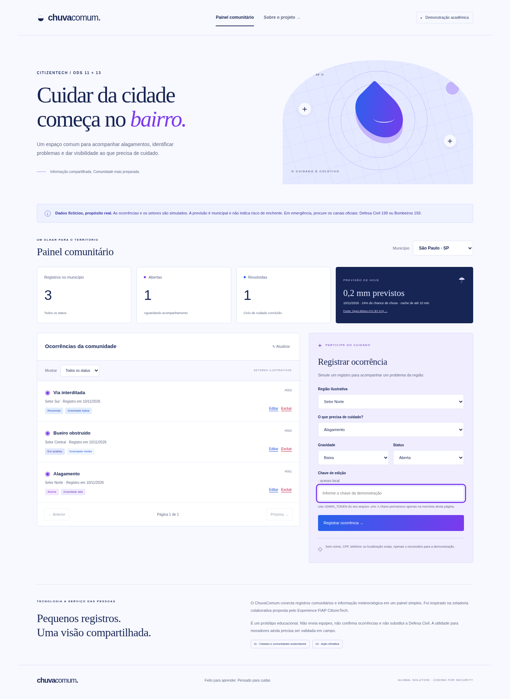

# ChuvaComum

**Cuidado que começa no bairro.** Protótipo CitizenTech para registrar e acompanhar problemas relacionados a alagamentos, com contexto meteorológico municipal. Global Solution — Coding for Security, segundo semestre de 2026.

[Repositório GitHub](https://github.com/gabrielcarnevalli/chuva-comum) · [Relatório PDF de 3 páginas](docs/relatorio.pdf) · [Guia para a arguição](docs/ARGUICAO.md)



A interface usa uma paleta de **azul e roxo**. Há uma aba de mensagem inicialmente oculta: pressione **Alt + Shift + H** ou clique cinco vezes seguidas no logo do cabeçalho para abrir Hebreus 13:8. Use **Voltar ao painel** ou **Esc** para retornar. A aba é um easter egg da interface; não protege credenciais nem substitui a autenticação das operações da API.

## Problema antes da tecnologia

**Cidadão:** morador de área urbana sujeita a alagamentos, especialmente quem tem dificuldade para acompanhar o que acontece na região. **Operador do protótipo:** representante comunitário com chave local de edição. **Necessidade proposta:** reunir registros dispersos e acompanhar se um problema continua aberto, está em análise ou foi resolvido.

**Evidência pública:** o estudo IBGE/Cemaden publicado em 2018 identificou **8.270.127 moradores em áreas de risco em 872 municípios, com base no Censo 2010**. É um dado histórico, não uma estimativa de 2026. Ele comprova exposição ao problema; não comprova demanda ou eficácia desta interface. Não foram inventadas entrevistas ou validações com cidadãos.

**Inspiração FIAP:** “Plataformas de zeladoria colaborativa para identificar, priorizar e acompanhar problemas dos espaços públicos”, na [página do evento](https://experience.fiap.com.br/global-solution-citizen-tech). O projeto aplica essa inspiração aos alagamentos. Se a professora exigir confirmação específica da ideia, obtenha-a antes da entrega.

**ODS 11:** apoio à participação comunitária (11.3) e à organização de informação sobre desastres (11.5). **ODS 13:** apoio à preparação e adaptação local (13.1). São contribuições pretendidas; redução de danos não foi medida.

> Demonstração exclusivamente fictícia. Setores Norte, Central e Sul são regiões ilustrativas, não bairros geográficos cadastrados. A previsão é municipal, não prevê alagamentos nem indica uma rota segura. O sistema não aciona serviços públicos. Emergência: Defesa Civil 199 / Bombeiros 193.

## Executar do zero

### Requisitos

- Python **3.11 ou superior** (validado com 3.12.14).
- Docker Engine/Desktop ativo e Docker Compose v2 com suporte a `--wait`.
- Internet para instalar pacotes, baixar MySQL e consultar Open-Meteo.
- Portas locais **3307**, **5000** e, para a demonstração TCP, **5050** livres.

Baixe e extraia o ZIP ou clone seu repositório. Entre na pasta que contém este README. O Docker executa somente o banco; o Python executa a aplicação e o módulo TCP.

**Linux / macOS:**

```bash
python3 -m venv .venv
source .venv/bin/activate
python -m pip install -r requirements.txt
python scripts/configurar.py
docker compose up -d --wait db
python -m scripts.semear
python run.py
```

**Windows PowerShell:**

```powershell
py -3 -m venv .venv
.\.venv\Scripts\python.exe -m pip install -r requirements.txt
.\.venv\Scripts\python.exe scripts/configurar.py
docker compose up -d --wait db
.\.venv\Scripts\python.exe -m scripts.semear
.\.venv\Scripts\python.exe run.py
```

Abra **http://127.0.0.1:5000**. O banco recebe cinco registros fictícios, se estiver vazio. A configuração gera senhas e tokens aleatórios em `.env`, preserva um arquivo já existente e não mostra segredos no terminal. O esquema é criado pelo MySQL na primeira inicialização de um volume vazio. Em Linux, o arquivo `sql/01_schema.sql` precisa estar legível pelo contêiner (`chmod 644 sql/01_schema.sql`, se necessário).

Para **criar, editar ou excluir**, abra seu `.env` localmente e copie o valor de `ADMIN_TOKEN` para o campo **Chave de edição**. Não coloque esse valor no código, em capturas de tela, na URL ou no GitHub. A interface mantém a chave apenas em memória; recarregar a página a apaga. GET é público e expõe somente registros fictícios, sem dados pessoais.

### Módulo sockets TCP

Com a mesma configuração e o banco ativo, abra dois terminais na raiz do projeto com o ambiente virtual ativado:

```bash
# Terminal 2: servidor, somente em loopback
python tcp_server.py
```

```bash
# Terminal 3: cliente
python tcp_client.py
```

No Windows, substitua `python` por `.\.venv\Scripts\python.exe`. O cliente lê `TCP_TOKEN` do `.env`, envia um JSON terminado por `\n` e recebe contagens por status. É uma demonstração de consulta textual leve, com rede e banco disponíveis; não funciona sem conectividade ao servidor. Protocolo e limites em [docs/API.md](docs/API.md). Não há integração com LLM: **sockets TCP** é o módulo escolhido.

### Encerrar e resolver falhas

- `Ctrl+C` encerra cada servidor Python. `docker compose down` encerra o banco e preserva o volume.
- “Serviço de dados indisponível”: confira `docker compose ps` e `docker compose logs db`; confirme as variáveis do `.env`, porta 3307 e a criação do esquema.
- `.env` não deve ser recriado após a criação do volume: mudar senhas no arquivo não muda automaticamente as senhas dentro do MySQL. Preserve os segredos ou faça uma manutenção de senha deliberada.
- Volume criado antes da carga do esquema não executa os scripts novamente. Investigue os logs; não remova volumes que contenham dados que você deseja preservar. `docker compose down -v` **apaga todos os registros do projeto** e só serve para reinicialização deliberada de uma demonstração descartável.
- Previsão indisponível: o sistema mostra essa condição e continua com o CRUD; não apresenta amostras como previsão real. A previsão exige HTTPS para `api.open-meteo.com`.
- Não exponha as portas na internet. A configuração proposta usa localhost. Uma implantação pública exigiria autenticação por usuário, TLS, revisão operacional e moderação.

## O que foi construído

| Exigência | Implementação / evidência |
|---|---|
| Flask REST, quatro verbos | GET/POST `/api/ocorrencias`; PUT/DELETE `/api/ocorrencias/<id>` |
| MySQL sem ORM, CRUD Python | `app/db.py`, `app/repository.py`, MySQL 8.4.7 |
| Fonte externa, requests + JSON | `app/weather.py`, GET auxiliar `/api/clima?cidade=sao-paulo` |
| Interface HTML/CSS consumindo API | `app/templates/index.html`, `app/static/app.js`, Fetch API |
| Log com data/hora, ação, resultado | `logs/auditoria.log`, UTC e rotação de arquivos |
| Módulo à escolha | Servidor e cliente TCP autenticados, consulta ao banco |
| Funções, módulos e exceções | Validação separada, transações e handlers JSON |
| Segurança obrigatória | `.env`, SQL com `%s`, listas permitidas, erros genéricos, minimização |
| Entregas | README, requirements, `.env.example`, relatório PDF de 3 páginas e fontes editáveis |

São **quatro rotas de operação CRUD**, mais uma rota GET meteorológica auxiliar e a página HTML. Códigos, exemplos e modelo em [docs/API.md](docs/API.md).

```text
Navegador HTML/CSS/JS → Flask / Waitress → Repositório SQL → MySQL
                              ↓ requests / JSON / HTTPS
                           Open-Meteo
Cliente TCP → Servidor TCP → Repositório SQL → MySQL
              Flask e TCP → auditoria em arquivo (UTC)
```

Consulte [arquitetura e modelo de dados](docs/ARQUITETURA.md) e [três ameaças e mitigações](docs/SEGURANCA.md). O projeto usa dicionários para configuração/dados, listas para registros, tuplas para parâmetros SQL e uma fila `deque` no controle de requisições.

## Validação reproduzível

Instale dependências de desenvolvimento no ambiente virtual:

```bash
python -m pip install -r requirements-dev.txt
python -m pytest -m "not integration" -q
python -m ruff check .
```

Com MySQL ativo, **Linux/macOS**:

```bash
RUN_INTEGRATION=1 python -m pytest --cov=app --cov-report=term-missing -q
```

**PowerShell**, usando o executável do ambiente virtual:

```powershell
$env:RUN_INTEGRATION="1"
.\.venv\Scripts\python.exe -m pytest --cov=app --cov-report=term-missing -q
Remove-Item Env:RUN_INTEGRATION
```

Os testes de integração criam e removem somente seus próprios registros. Execute-os em ambiente de demonstração. Sem a variável, são marcados como ignorados e não contam como verificação de MySQL.

Com a aplicação também ativa, `python -m scripts.demonstrar_api` demonstra os quatro verbos e erros de segurança por HTTP. Não exibe tokens. O teste opcional de navegador é `python -m scripts.validar_navegador`: usa Playwright e o Chromium indicado por `CHROMIUM_PATH` ou `/usr/bin/chromium`. Em outra instalação, forneça o caminho do seu Chrome/Chromium. Ele cria/exclui apenas seu registro fictício e salva capturas e resultados.

Resultados e condições reais da execução estão em [docs/VALIDACAO.md](docs/VALIDACAO.md), com evidências em `docs/evidencias/`. Não houve piloto com moradores. A proposta de validação em campo está documentada separadamente dos testes executados.

## Relatório e apresentação individual

O [relatório PDF](docs/relatorio.pdf) tem **3 páginas**, em preto e branco. Há também uma [versão editável em Word](docs/relatorio.docx), igualmente em preto e branco. O texto-fonte está em [docs/RELATORIO.md](docs/RELATORIO.md). Para preencher sua identificação e gerar novamente o PDF:

```bash
python -m scripts.gerar_relatorio --nome "Seu nome" --rm "Seu RM" --turma "Sua turma"
```

Para aplicar preto e branco a uma cópia de um Word editado, preservando o texto: `python scripts/formatar_relatorio_word.py entrada.docx saida.docx`.

O roteiro [docs/ARGUICAO.md](docs/ARGUICAO.md) explica o fluxo, as decisões e uma demonstração de cinco minutos. **Não entregue código que não consegue explicar.** A geração inicial deste material teve participação substancial de IA, explicitada no relatório e em [docs/CREDITOS.md](docs/CREDITOS.md). A regra da disciplina menciona IA para estudo e depuração; confirme com a professora se a extensão da assistência usada aqui é aceita. Revise, execute, adapte e compreenda o projeto individualmente.

## GitHub e pacote

O pacote não inclui `.env`, banco, ambiente virtual ou credenciais. Inclui dados de exemplo sintéticos, evidências e documentação. Para gerar um ZIP novamente, execute `python -m scripts.empacotar`.

Repositório destinado ao projeto: **https://github.com/gabrielcarnevalli/chuva-comum**. A publicação dos arquivos ainda está pendente: o plugin, a API e o envio por Git recusaram gravação com HTTP 403, embora a conta autentique para leitura. O ZIP fornecido contém a solução completa; o repositório remoto foi confirmado apenas com o README inicial.

Para publicar pela sua sessão autenticada no navegador, extraia o ZIP e envie **o conteúdo** da pasta `chuva-comum` em [Upload files](https://github.com/gabrielcarnevalli/chuva-comum/upload/main), preservando arquivos como `.env.example` e `.gitignore`. O pacote não contém `.env` nem credenciais reais.

Depois da publicação, o código poderá ser baixado pelo Git:

```bash
git clone https://github.com/gabrielcarnevalli/chuva-comum.git
cd chuva-comum
```

Após a publicação, também será possível usar **Code → Download ZIP** no GitHub. No pacote entregue, o PDF está em `docs/relatorio.pdf`, com fonte editável em `docs/RELATORIO.md`. Entregue o **link do repositório com o código publicado**, o **ZIP** e o **PDF**. Preencha sua identificação e observe as regras individuais; nenhum resultado de nota é garantido.

## Referências

- [FIAP — Global Solution CitizenTech](https://experience.fiap.com.br/global-solution-citizen-tech), inspiração e contexto.
- [IBGE — população em áreas de risco, divulgação de 28/06/2018](https://agenciadenoticias.ibge.gov.br/agencia-sala-de-imprensa/2013-agencia-de-noticias/releases/21565-em-2010-brasil-tinha-8-3-milhoes-de-pessoas-morando-em-areas-com-risco-de-desastres-naturais), base Censo 2010.
- [Open-Meteo — documentação](https://open-meteo.com/en/docs), previsão municipal; dados [CC BY 4.0](https://creativecommons.org/licenses/by/4.0/), uso da API sujeito aos termos do provedor.
- [ODS 11](https://brasil.un.org/pt-br/sdgs/11) e [ODS 13](https://brasil.un.org/pt-br/sdgs/13), Nações Unidas Brasil.
- [LGPD — Lei 13.709/2018](https://www.planalto.gov.br/ccivil_03/_ato2015-2018/2018/lei/l13709.htm), finalidade e necessidade como orientação de projeto.

Fontes consultadas em 10/11/2026. Bibliotecas e assistência de IA declaradas em `docs/CREDITOS.md`.
