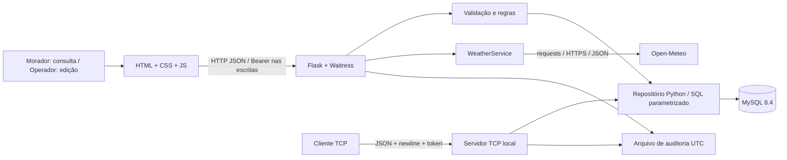
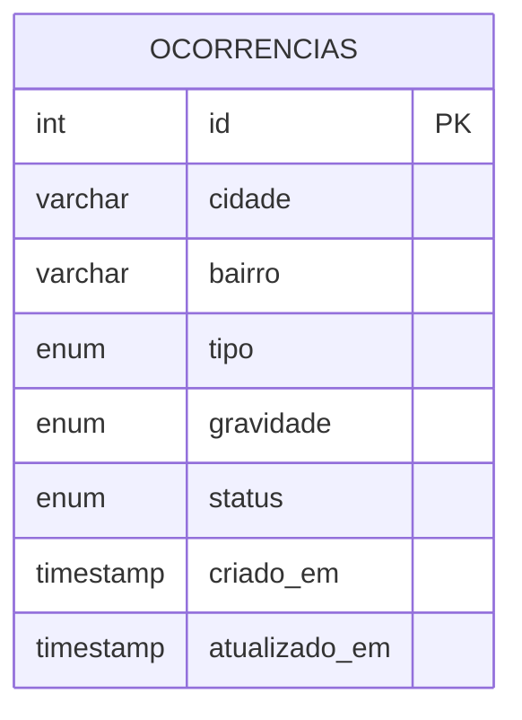

# Arquitetura e modelo

## Componentes e responsabilidade

1. HTML/CSS/JS, servidos pelo Flask na mesma origem: seleção de município, previsão, indicadores, filtros, formulário, edição e exclusão com confirmação. `fetch` envia/recebe JSON. A chave de edição nunca é embutida no HTML.
2. Waitress executa a aplicação WSGI sem debugger. A fábrica `create_app` permite injetar dependências nos testes; em execução normal cria serviços reais.
3. Flask verifica limite de requisições, token nas escritas, valida entradas e traduz falhas para mensagens públicas sem detalhes internos.
4. `OccurrenceRepository` executa SQL com parâmetros `%s` no MySQL Connector. `connection` abre conexão, faz commit em sucesso, rollback em falha e fecha recursos. Não há ORM nem SQLite substituindo o banco exigido.
5. `WeatherService` acessa exclusivamente Open-Meteo por HTTPS com `requests`, parâmetros de coordenadas fixos, timeout, validação do JSON e cache em memória por até dez minutos. Previsão representa coordenadas centrais do município, não setores ou sensores locais.
6. Servidor TCP oferece somente leitura agregada com outra credencial. Compartilha o repositório SQL, sem depender da API Flask. Cliente e servidor usam o mesmo host local no protótipo. A comunicação requer conectividade e não é uma solução offline.
7. Flask, serviço meteorológico e servidor TCP registram ações e resultados em arquivo, sem dados de requisição. Cada processo usa `RotatingFileHandler`; para produção multiprocesso, centralizar auditoria em um serviço próprio.

## Modelo de dados

Uma ocorrência é um problema coletivo ilustrativo, não um cadastro de pessoas. Uma única tabela é suficiente para a entidade do escopo. Evitar tabela de cidadãos reduz coleta e complexidade. Cidades, regiões, tipos e estados são listas permitidas também no Python.

| Coluna | Tipo | Regra |
|---|---|---|
| id | INT UNSIGNED PK AUTO_INCREMENT | identificador técnico; API aceita até 2.147.483.647 |
| cidade | VARCHAR(30) NOT NULL | sao-paulo, porto-alegre, recife; CHECK |
| bairro | VARCHAR(30) NOT NULL | Setor Norte, Setor Central, Setor Sul; CHECK; campo legado nomeado bairro, valor ilustrativo |
| tipo | ENUM NOT NULL | alagamento, bueiro_obstruido, via_interditada |
| gravidade | ENUM NOT NULL | baixa, media, alta |
| status | ENUM NOT NULL | aberta, em_analise, resolvida |
| criado_em | TIMESTAMP(6) NOT NULL | gerado pelo banco |
| atualizado_em | TIMESTAMP(6) NOT NULL | atualizado pelo banco em mudança efetiva |

Índice composto `(cidade, status)` para filtros. Banco em `utf8mb4`, conexão em UTC, serialização ISO 8601 com `Z`. Listagem paginada, máximo de 100 registros por resposta. As transições de status são livres no protótipo para demonstrar PUT; não há fluxo oficial de homologação. Um PUT idêntico retorna 200 sem criar novo registro. Exclusão é física e intencionalmente acessível apenas ao operador.

O script SQL é executado pela conta administrativa apenas na inicialização. A aplicação utiliza `chuva_app`, com SELECT/INSERT/UPDATE/DELETE, sem CREATE, DROP ou administração de contas. Senha root não é lida pela aplicação Python.

## Decisões e recursos adicionais

- **MySQL:** atende ao conteúdo, permite demonstrar SQL parametrizado e persistência em volume.
- **Sockets TCP:** escolha prevista no enunciado, sem custo/token de LLM. Framing explícito demonstra por que um `recv` não equivale a uma mensagem.
- **Open-Meteo:** acesso público, formato JSON documentado, sem cadastro de moradores ou envio de observações ao provedor. Só coordenadas municipais fixas saem do sistema.
- **Docker Compose:** adicional para reproduzir a versão do banco e o esquema sem instalação manual do MySQL no sistema operacional.
- **Pytest, cobertura e teste de navegador:** adicionais para evidenciar comportamentos, falhas e integração, sem afirmar qualidade apenas por porcentagem.
- **CSP, limite de requisições e Waitress:** adicionais que tornam a demonstração mais previsível e reduzem execução de scripts e abuso. Não equivalem a hardening de produção.

Não há integração institucional, georreferenciamento preciso, sensor hidrológico, IA preditiva, envio de alertas, moderação ou identificação individual de operadores.
